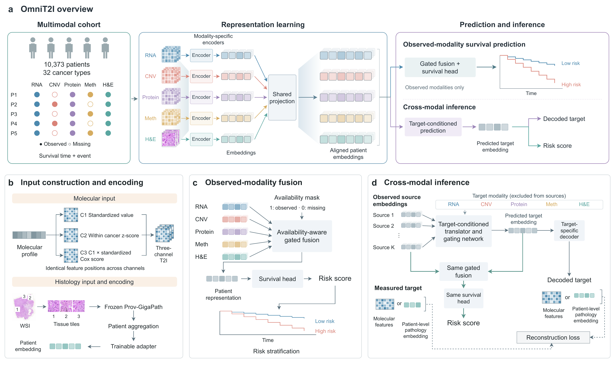

# OmniT2I

A unified table-to-image framework for survival prediction and cross-modal inference with incomplete multimodal cancer data.

OmniT2I combines RNA, copy number, protein/RPPA, DNA methylation and H&E representations. It predicts survival from available modalities and infers withheld molecular profiles or H&E embeddings. The four molecular modalities use a shared serpentine placement path for their three-channel images.

**Paper:** [OmniT2I: a unified table-to-image framework for survival prediction and cross-modal inference with incomplete multimodal cancer data](https://www.biorxiv.org/content/10.64898/2026.11.08.765158v1) · bioRxiv, 2026



## Installation

Run the commands below from the repository root. Create a Python 3.11 environment and install the dependencies:

```bash
git clone https://github.com/stevenli11/OmniT2I.git
cd OmniT2I
conda create -n omnit2i python=3.11 -y
conda activate omnit2i
pip install -r requirements.txt
```

The requirements include the package itself and the dependencies for molecular preprocessing, training and analysis. They pin PyTorch 2.4.1; for GPU use, install the matching CUDA build from the [PyTorch installation instructions](https://pytorch.org/get-started/previous-versions/#v241) before installing the requirements. H&E extraction needs the additional packages listed under [Pretrained models](#pretrained-models). For just the core package, use `pip install .` instead of the requirements file.

## Quick start

Try the model components with synthetic data:

```bash
python examples/model_components.py
```

Then run a short example covering molecular preprocessing, training, fusion, cross-modal inference and evaluation:

```bash
python examples/multimodal_workflow.py --output-dir outputs/synthetic_multimodal
```

Both examples generate data locally and use randomly initialized models. They require no patient data, pretrained weights or Hugging Face account.

## Data

Download the public inputs from their original repositories:

| Data | Source |
| --- | --- |
| TCGA molecular matrices | [UCSC Xena, TCGA Pan-Cancer Atlas](https://xenabrowser.net/datapages/?hub=https://pancanatlas.xenahubs.net:443) |
| TCGA overall survival | [TCGA Pan-Cancer Clinical Data Resource](https://doi.org/10.1016/j.cell.2018.02.052) |
| TCGA H&E slides and case metadata | [GDC Data Portal](https://portal.gdc.cancer.gov/) |
| CPTAC expression and clinical records | [LinkedOmics](https://www.linkedomics.org/data_download/), [cBioPortal](https://github.com/cBioPortal/datahub/tree/master/public), and GDC |
| SCAN-B expression and clinical records | [GEO GSE96058](https://www.ncbi.nlm.nih.gov/geo/query/acc.cgi?acc=GSE96058) |

Cohort-specific releases and adopted inputs are listed in the manuscript's Supplementary Table 20. Downloaded patient data stay local and are not bundled in this repository. Input formats and preparation commands are in the [data preparation guide](docs/workflows.md#cohort-assembly).

## Pretrained models

### OmniT2I checkpoints

Trained OmniT2I weights will be released after publication. The training code and synthetic examples are available now.

### Prov-GigaPath for H&E extraction

The H&E branch uses the frozen **Prov-GigaPath tile encoder** (`prov-gigapath/prov-gigapath`) to produce 1,536-dimensional embeddings. Tile embeddings are mean-pooled within slides, then slides receive equal weight when pooling to a patient representation. The GigaPath slide encoder is not required.

1. **Obtain model access.** Sign in to [Hugging Face](https://huggingface.co/join), open the [Prov-GigaPath model page](https://huggingface.co/prov-gigapath/prov-gigapath), and accept the provider's terms/request access. Wait until access is granted. This browser step is required by the provider.
2. **Install the H&E dependencies** in the same `omnit2i` environment:

   ```bash
   pip install '.[he]' 'torch==2.4.1' 'torchvision==0.19.1' huggingface_hub
   ```

3. **Choose a cache directory and log in.** Create a read token at [Hugging Face → Settings → Access Tokens](https://huggingface.co/settings/tokens) using the account with model access. Run:

   ```bash
   export HF_HOME="$HOME/.cache/huggingface"
   python -c "from huggingface_hub import login; login()"
   ```

   Paste the token at the prompt; Git credential storage is not needed for these commands. On a cluster, set `HF_HOME` to a persistent directory with enough space and use the same value in extraction jobs. The cached login is reused; do not put the token in scripts or commit it.
4. **Download and check the tile encoder** once on a machine with internet access:

   ```bash
   python - <<'PY'
   import torch
   from omnit2i.preprocessing.he_case_embeddings import load_gigapath_tile_encoder

   model = load_gigapath_tile_encoder(torch.device("cpu"))
   print("Embedding dimension:", model.num_features)
   PY
   ```

   The expected dimension is `1536`. The loader downloads the required model files automatically to the Hugging Face cache; no manual checkpoint path is needed. A `401`/`403` error usually means access has not been granted or the token belongs to a different account.
5. **Extract embeddings from your slides.** Prepare `one_slide_per_patient.tsv` with columns `case_id,file_name`, and place the corresponding slide files under `slides/`. Run:

   ```bash
   omnit2i-sample-he --table one_slide_per_patient.tsv --svs-root slides \
     --outdir patches --report-dir reports
   omnit2i-embed-he --patch-table patches/full_he_64patch_bag_patch_table.tsv \
     --outdir embeddings --device cuda
   ```

   Use `--device cpu` if CUDA is unavailable. The case embedding table is written to `embeddings/full_he_gigapath_64patch_mean_case_mean_embeddings.tsv`. See [H&E preprocessing](docs/workflows.md#he-preprocessing) for additional slides, patient pooling and alignment to the molecular cohort.

The encoder and its access terms are supplied by [Prov-GigaPath](https://huggingface.co/prov-gigapath/prov-gigapath); they are separate from the OmniT2I code license.

## Usage

After the synthetic example, follow the commands for your own data:

- [Data preparation, model training and inference](docs/workflows.md)
- [Survival and cross-modal analyses from saved predictions](analysis/README.md)
- [Manuscript figures from Source Data](figures/README.md)

## Citation

If you use OmniT2I in your research, please cite:

```bibtex
@article{li2026omnit2i,
  title   = {{OmniT2I}: a unified table-to-image framework for survival prediction and cross-modal inference with incomplete multimodal cancer data},
  author  = {Li, Peng and Majeed, Zuhair and Niazi, Muhammad Khalid Khan and Hasanov, Merve and Hasanov, Elshad},
  journal = {bioRxiv},
  year    = {2026},
  doi     = {10.64898/2026.11.08.765158},
  url     = {https://www.biorxiv.org/content/10.64898/2026.11.08.765158v1}
}
```

## License

Copyright 2026 The Ohio State University. Licensed under the [PolyForm Noncommercial License 1.0.0](LICENSE). Commercial use requires separate permission from the rights holder. Third-party models and datasets retain their own licenses and access terms.

Principal developer: **Peng Li**, Hasanov Lab, The Ohio State University.
